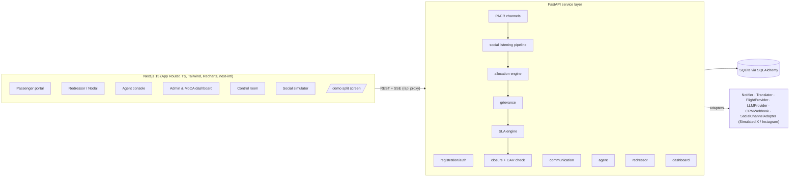

# AirSewa 3.0 + PACR - working prototype

Clickable end-to-end prototype of the Ministry of Civil Aviation / AAI **AirSewa** grievance platform and the **Passenger Assistance Control Room (PACR)**, built from the RFP in `scope of work.md`.

> **No real external system is connected.** The X and Instagram apps are *fake* apps built into this project (own icons, no brand assets), and SMS, e-mail, WhatsApp, IVR, CPGRAMS, flight data, airline CRMs and LLMs are all mocked behind adapters. Everything simulated is labelled **"Simulated"** in the UI. Data is synthetic.

## Run it (one command)

Requirements: Node 20+, Python 3.11+.

```bash
npm run dev          # first run: creates api/.venv, installs deps, seeds the DB, starts API :8000 + web :3000
```

- Web: <http://localhost:3000> · API docs (OpenAPI): <http://localhost:8000/docs>
- `npm run seed` re-creates the database (about 3,000 tickets, about 300 simulated social posts, story tickets).
- `npm test` runs the pytest suite (87 tests). `node e2e/demo.mjs` and `node e2e/portal.mjs` are optional Playwright smoke tests (`cd e2e && npm i && npx playwright install chromium`).
- Docker alternative: `docker compose up --build` (the compose file is provided but was not exercised in the build environment).

Windows PowerShell and macOS/Linux are both supported by `scripts/dev.mjs`.

## Demo accounts

Password for every account: `Demo@1234`. Passenger OTP (simulated, shown in a dev toast): `123456`.

| Role | Login | Notes |
|---|---|---|
| Passenger (registered) | `passenger@demo.in` / mobile `9000000001` | owns the story tickets |
| AirSewa Agent (PACR) | `agent1@pacr.demo` … `agent6@pacr.demo` | review queue, social feed, overrides, committee |
| Admin / MoCA-AAI | `admin@moca.demo` | dashboard, rules, SLA/CAR, watch list, demo clock, users |
| Control Room Manager | `manager@pacr.demo` | PU productivity and penalty simulation |
| Nodal Officer | `nodal.<org>@demo.in` e.g. `nodal.6e@demo.in` (IndiGo), `nodal.ai@demo.in`, `nodal.sg@demo.in`, `nodal.dial@demo.in` | manages staff, sees whole organisation |
| Redressor staff | `<org>.l1a@demo.in`, `<org>.l1b@demo.in`, `<org>.l2@demo.in`, `<org>.l3@demo.in` e.g. `6e.l2@demo.in`, `ai.l2@demo.in`, `dial.l1a@demo.in` | L1 sees S2-S4, L2+ also S1 |

Org codes: airlines `6E AI QP SG IX S5 9I I5`, airport operators `AAI DIAL MIAL BIAL GHIAL CIAL`, regulators `DGCA BCAS CISF CUSTOMS IMMIG`, ground handlers `SATS CELEBI BIRD`, OTAs `MMT CLEAR`. The login page has one-click fill buttons for the main demo accounts.

Follow `docs/DEMO_SCRIPT.md` for a 10-minute walkthrough.

## What is in it

- **Passenger portal** - register/login (mobile or e-mail + simulated OTP), guest login with consent-to-save, grievance form for the 5 FRS categories with per-category mandatory fields, PDF/JPG/PNG ≤10 MB upload, consent, unique ticket ID, live "critical keyword" hint and TAT display, tracking timeline, reopen (max 2), escalate, feedback, dispute, public flight tracking, rule-based EN/HI chatbot with agent handoff.
- **Allocation engine** (rule-based, editable at `/admin/rules`) - keyword → category/sub-category → stakeholder, severity matrix S1-S4 with the matched "severity reason", S1 to L2+, S2-S4 to L1. The same engine serves the portal, social posts and all PACR channels.
- **Lifecycle** - Under Assessment → Assigned → In-Progress → On Hold → Provisionally Resolved → Resolved (+ Reopened, Escalated, Closed) with an immutable event log.
- **SLA engine** - multiple policies, near-breach warnings to L3/Nodal, auto-escalation L1→L2→L3→Nodal→PACR, breach flags, and an admin **demo clock** to fast-forward time.
- **Closure rules** - evidence mandatory, AI-style CAR/DGCA compliance check (illustrative rule base), passenger confirmation, reopen cap, disputes to the Case Closure Committee queue.
- **Redressor / Nodal / Agent / Admin consoles** - queues, actions, divert/add redressor, severity override rules, staff management, bulk actions, merge duplicates (parent/child), reverify closure.
- **MoCA dashboard** - RFP 2.5.13 widgets with filters, exports (CSV/XLSX/PDF), live updates over SSE, social pulse, forecast and what-if widgets.
- **Control room** - PU per agent per shift, the RFP 2.28 penalty slabs and the 10% cap.
- **Social Simulator + real-time detection** - X-style and Instagram-style apps, a watch list, a staged pipeline (receive → relevance filter → translate → classify → de-duplicate → draft) with millisecond timings, virality handling, S1 alert toast/sound, approve/edit/reject, acknowledgment replies into the fake apps, and a split-screen `/demo`.
- **Other PACR channels (Simulated)** - WhatsApp, e-mail, IVR transcript, CPGRAMS, scanned letter feed the same pipeline with cross-channel duplicate detection.
- **Airline CRM webhook (Simulated)** at `/crm`, **API sandbox** (API keys, rate limit, usage) at `/admin/api`.

## Architecture



Key choices: one `classify()` engine, one application clock (`clock.now()`, used by SLA/escalation), an in-process SSE bus for live feeds, adapters registered in `api/app/adapters/__init__.py` (add a real SMS gateway or social adapter there without touching business logic), RBAC in `api/app/deps.py`, masking in the serialisers.

## Module → RFP section

| Module (code) | RFP / FRS |
|---|---|
| `routers/auth.py` | 2.5 registration, FRS 3.1 |
| `modules/grievance.py`, `routers/tickets.py` | 2.5 grievance, FRS 3.2, 3.3 (lifecycle, event log) |
| `modules/allocation.py`, `routers/admin.py` rules | 2.5.35, FRS 3.3 (engine, severity matrix) |
| `modules/sla.py` | 2.5.12, FRS 3.8 |
| `modules/closure.py` | 2.5.9, FRS 3.8 #8-9 |
| `adapters/`, `modules/grievance.notify_*` | FRS 3.4 (communication, simulated) |
| `routers/tickets.py` agent actions, `social_api.py` PACR | 2.5.11, FRS 3.5 |
| `routers/tickets.py` staff actions, `admin.py` users | 2.5.10, FRS 3.6, 3.7 |
| `modules/dashboard.py`, `routers/analytics.py` | 2.5.13, FRS 3.9, 2.28 (PU/penalty) |
| `modules/social.py`, `routers/social_api.py`, `components/Simulator.tsx`, `PacrFeed.tsx` | 2.5.25-2.5.31, 2.5.35, Annexure-II |
| `routers/misc.py` (chatbot, flights, CRM), `routers/v1.py` | 2.5.21, 2.5.26-2.5.29 |

Row-by-row status is in `docs/FRS_TRACEABILITY.md`; RFP contradictions and decisions are in `docs/ASSUMPTIONS.md`.

## Configuration

Copy `.env.example` if you want to change defaults (`DEMO_MODE`, `JWT_SECRET`, `SESSION_IDLE_MINUTES`, optional `LLM_PROVIDER=openai` + `LLM_API_KEY` for the chatbot; without a key the chatbot uses deterministic intent rules). No secrets are stored in the repository; the dev JWT secret is generated into `api/.jwt_secret` (git-ignored).

## Security notes

bcrypt password hashes, httpOnly JWT cookie with sliding idle expiry, pydantic validation, ORM-parameterised queries, file type/size/magic-byte validation, append-only ticket events and audit log, role-based visibility, PII masking (contact data for non-agents, social handles, notification recipients), data-retention setting and an admin "Purge social data" button.

## Known limits

Single-node SQLite, no real MFA for staff, no daily e-mail report jobs, notification preferences, training manuals or Facebook/YouTube simulators. Translation uses a small mock dictionary. Language coverage: English and Hindi on all passenger flows; staff analytics screens are English.

## Future scope (not built)

Voice chatbot, real telephony/CTI, real social-media APIs, Meghraj 2.0 hosting, SIEM/SOAR integration, STQC audit, GIGW certification.
